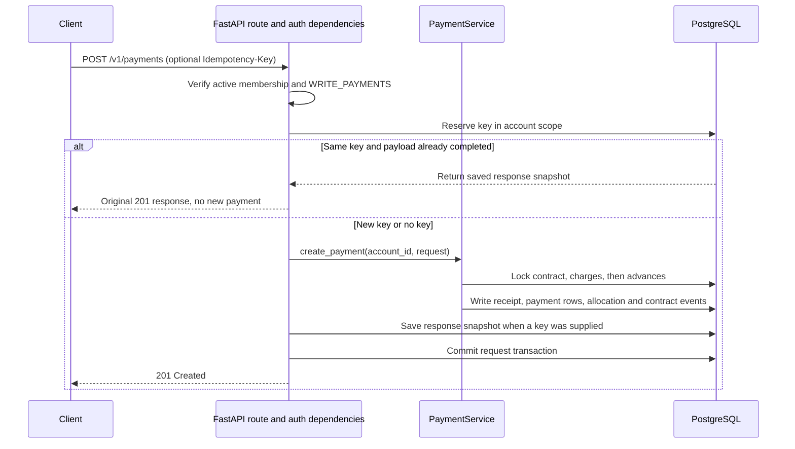

# Landlords

**Rental operations for landlords and property managers.** Landlords brings properties, leases, rent charges, payments, and expenses into one workspace, so teams can see what is due, what has been paid, and what remains.

[](https://github.com/vladweat/landlords/actions/runs/42007124711)

> Screenshot TODO: Add a real capture from the isolated synthetic demo.

## What it does

- Manage rental properties, tenants, lease contracts, and documents.
- Generate rent charges; record partial or full payments; carry advances and allocate them FIFO.
- Review contract balances and payment history, and track property expenses and portfolio returns.
- Share an account with owner, manager, and accountant roles; tenants can view balances and receipts in a self-service portal.

## Engineering highlights

- **Tenant-scoped authorization:** active membership and role permissions are checked in FastAPI dependencies; PostgreSQL RLS and account-filtered repositories add data-layer isolation. See [`deps.py`](backend/app/api/deps.py), [`tenant_context.py`](backend/app/db/tenant_context.py), and [cross-account integration tests](backend/tests/integration/test_multi_tenacy.py).
- **Auditable financial writes:** payment operations use `Decimal` and contract-scoped locks. Immutable receipts and allocation/correction/reversal events preserve payment history; optional request idempotency replays a saved response. See [`PaymentService`](backend/app/services/payment_service.py), [`payment_allocation.py`](backend/app/services/payment_allocation.py), and [PostgreSQL payment tests](backend/tests/integration/test_payments_api.py).
- **Transactional background dispatch:** charge-generation commands are written to PostgreSQL with the initiating change, then leased and published by a relay. Delivery is at-least-once, so the task uses a stable ID to make duplicate processing a no-op. See [`TaskOutboxService`](backend/app/services/task_outbox_service.py), [`OutboxRelay`](backend/app/services/outbox_relay.py), and [outbox integration tests](backend/tests/integration/test_outbox_relay.py).

## Payment request flow



## Quickstart: synthetic demo

Requires Docker Engine and the Docker Compose plugin. This sandbox uses separate named volumes, an internal network, and a loopback-only API; its records are synthetic and it has no configured payment or email provider.

```bash
docker compose --project-name landlords-demo -f docker-compose.demo.yml up -d --build
docker compose --project-name landlords-demo -f docker-compose.demo.yml exec api \
  python -m app.cli seed-demo
```

Open the local API explorer at <http://127.0.0.1:8001/docs>. The demo includes properties, tenants, contracts, rent charges, and partial payments. Login values are omitted from this README.

## Tests and CI

CI runs backend lint and unit/task tests, PostgreSQL integration tests, frontend tests and build, and a backend image build. The linked check-suite badge is pinned to the last verified upstream `main` run at SHA [`8d054ca`](https://github.com/vladweat/landlords/actions/runs/42007124711).

```bash
(cd backend && pytest -q tests/unit tests/tasks)
(cd backend && ruff check app tests --select E9,F63,F7,F82)
(cd frontend && npm ci && npm test && npm run build)
```

The PostgreSQL integration suite recreates `landlords_test`; use only the isolated test stack described in [testing.md](docs/development/testing.md).

## Known limitations

- Older payment rows are not backfilled with receipt/allocation history; they remain marked as legacy or unknown.
- The transactional outbox may publish a task more than once; the charge-generation task handles duplicates by stable task ID.
- Repository defaults do not configure off-site backup or an external Alertmanager receiver. The current restore check does not exercise the application ledger or tenant isolation.

## Documentation

- [Architecture](docs/architecture/overview.md) · [Database and transactions](docs/architecture/database.md) · [Background jobs](docs/architecture/background-jobs.md)
- [Money flow and ledger invariants](docs/money-flow.md) · [Roles](docs/multi-user-roles.md)
- [Local development](docs/development/getting-started.md) · [Testing](docs/development/testing.md) · [Deployment and synthetic demo](docs/deploy.md#локальный-synthetic-showcase)
