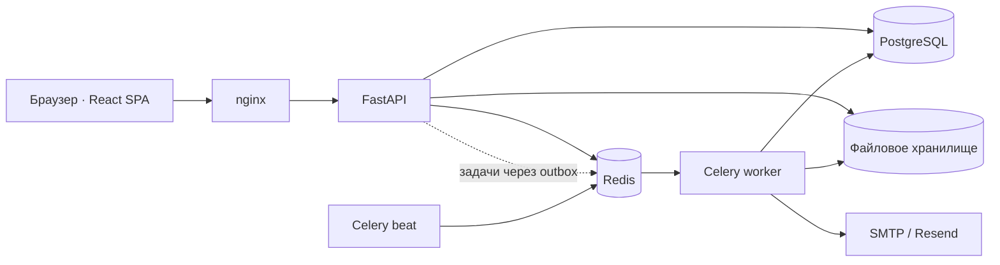

# Landlords

Landlords — CRM для арендодателя: помогает вести объекты, арендаторов и договоры,
планировать начисления, учитывать платежи и видеть денежный результат по
объектам. Основной поток проходит от договора и графика начислений к платежам,
ledger и отчёту по доходности.

## Что реализовано

- Объекты, арендаторы, договоры и документы.
- Начисления по договорам, частичные платежи, FIFO-распределение и авансы.
- Расходы, ROI, календарь и напоминания.
- Роли owner / manager / accountant и приглашения в аккаунт.
- Портал арендатора и публичные квитанции с ограниченными по времени ссылками.
- Фоновая обработка через Celery и Redis; transactional outbox для генерации
  начислений по договорам.
- Опциональная подписка Pro через интеграцию с ЮKassa; live-платежи не
  подтверждены.

## Архитектура

Приложение — модульный монолит. React SPA обращается к FastAPI через nginx;
PostgreSQL хранит бизнес-данные, Redis передаёт фоновые задачи Celery.
Документы хранятся в файловом volume.

Backend: Python 3.12, FastAPI, SQLAlchemy 2, Alembic, PostgreSQL 15, Redis 7 и
Celery. Frontend: React 19, TypeScript, Vite, TanStack Query, Zustand и
Tailwind CSS 4. Публичная конфигурация с HTTPS описана в
[runbook деплоя](docs/deploy.md); состояние production VPS в этом репозитории не
подтверждается.

## Посмотреть проект

[Интервью-маршрут](docs/PORTFOLIO.md) — демонстрация продукта за 5–10 минут,
ключевые инженерные решения и ограничения. В репозитории пока лежат SVG
заглушки вместо настоящих скриншотов; это отмечено в
[инструкции по изображениям](docs/assets/README.md).

## Запуск

Для локального запуска смотри отдельный
[гайд для нового разработчика](docs/development/getting-started.md). В нём
указаны требования к Docker/Node.js, подготовка конфигурации, сборка frontend и
запуск Compose. Подробные настройки, тесты и эксплуатационные команды вынесены
в [навигацию документации](docs/index.md).

## Инженерные решения

- [API и единый формат ответов](docs/api/overview.md)
- [Границы модулей и архитектура](docs/architecture/overview.md)
- [Схема данных и tenant isolation](docs/architecture/database.md)
- [Фоновые задачи и transactional outbox](docs/architecture/background-jobs.md)
- [Аутентификация и модель безопасности](docs/security/overview.md)
- [Текущие ограничения и риски](docs/maintenance/technical-debt.md)

## Текущие ограничения

- Production overlay с Caddy есть в репозитории, но DNS, сертификат и firewall
  целевой VPS не проверены.
- Backup и изолированный restore-check описаны и автоматизированы systemd units;
  установка расписания на VPS и offsite-копия не подтверждены. Restore-check не
  доказывает запуск восстановленного приложения.
- Реальные screenshots ещё не добавлены.
