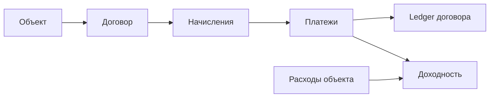

# Landlords

Landlords — CRM для арендодателей. В одном аккаунте можно вести объекты и
арендаторов, оформлять договоры, учитывать начисления, платежи и расходы, а
также следить за доходностью недвижимости.

## Возможности

- Объекты, арендаторы, договоры и документы.
- Автоматическое формирование начислений по договорам.
- Платежи с частичным погашением начислений, распределением и учётом аванса.
- Ledger договора, история оплат и квитанции.
- Расходы и показатели доходности по объекту и портфелю.
- Календарь платежей и напоминания.
- Роли owner, manager и accountant; приглашения участников в аккаунт.
- Портал арендатора для просмотра баланса, начислений и квитанций.
- Тарифные планы и тарификация подписки.

## Основной процесс

## Архитектура и технологии

Приложение построено как модульный монолит. React SPA обращается к FastAPI через
nginx. PostgreSQL хранит данные приложения, Redis используется для фоновых
задач Celery, а документы хранятся в файловом хранилище.

- Backend: Python 3.12, FastAPI, SQLAlchemy 2, Alembic, PostgreSQL 15, Redis 7 и Celery.
- Frontend: React 19, TypeScript, Vite, TanStack Query, Zustand и Tailwind CSS 4.

## Документация

- [Описание проекта и технических разделов](docs/index.md)
- [Архитектура приложения](docs/architecture/overview.md)
- [Денежный поток и правила ledger](docs/money-flow.md)
- [Договоры и платежи](docs/use-cases-contracts-payments.md)
- [Роли и доступ](docs/multi-user-roles.md)

## Разработка

Для настройки локального окружения есть отдельный
[гайд для разработчика](docs/development/getting-started.md).
