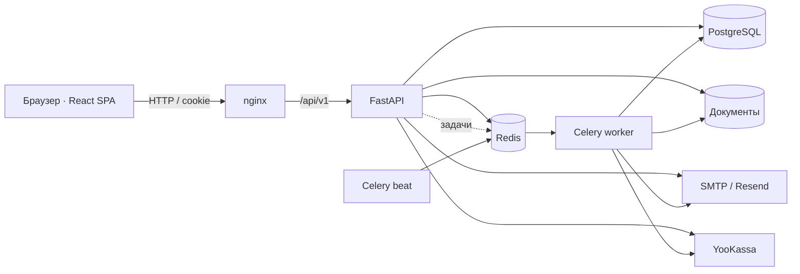
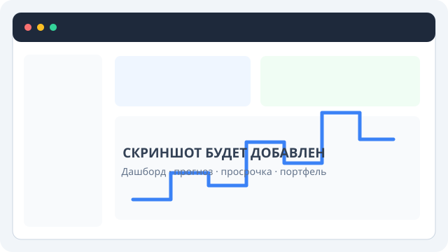
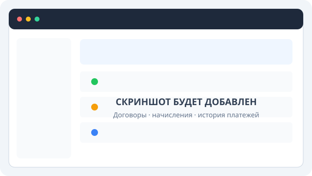
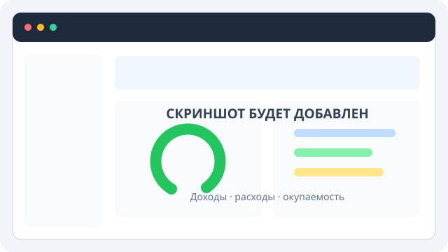

# Landlords

SaaS CRM для арендодателей. Реализованы объекты и арендаторы, жизненный цикл
договоров, начисления и платежи с ledger, расходы и ROI, документы и квитанции,
календарь, напоминания, роли аккаунта, портал арендатора, тариф Pro и публичная
регистрация, управляемая настройкой backend.

Backend — Python 3.12, FastAPI, SQLAlchemy 2, Alembic, PostgreSQL 15, Redis 7 и
Celery. Frontend — React 19, TypeScript, Vite, TanStack Query, Zustand и
Tailwind CSS 4. Стек запускается через Docker Compose; nginx обслуживает SPA и
проксирует `/api` в FastAPI.

## Как показать проект

Landlords — модульный монолит: React SPA общается с FastAPI через nginx; PostgreSQL
хранит бизнес-данные, Redis передаёт фоновые задачи Celery. Worker отправляет
письма и выполняет отложенные операции.



### Интерфейс

| Дашборд | Договоры и ledger | Доходность объекта |
|---|---|---|
|  |  |  |

Для короткой демонстрации:

1. Войдите под `demo@example.com` (команда `seed-demo` создаёт пароль
   `ChangeMeDemo1!` и showcase-данные: четыре объекта, арендаторов, договоры,
   оплаты, просрочку и расходы).
2. На дашборде покажите прогноз дохода, просрочку и доходность портфеля.
3. Откройте объект и разберите годовой доход, расходы и ROI.
4. В договоре покажите ledger, историю событий и публичный портал арендатора.
5. В отдельном браузере или после выхода из демо-аккаунта пройдите регистрацию
   нового владельца.

Не используйте демонстрационный пароль на публичном стенде. Для показа публичной
регистрации установите `ALLOW_PUBLIC_REGISTRATION=true` в `backend/.env` и
пересоздайте API-контейнер. При выключенной настройке ссылка регистрации
скрывается, а прямой переход на `/register` объясняет, что регистрация закрыта.

## Требования и быстрый старт

- Docker с Compose plugin;
- Node.js 20.19+ или 22.12+ и npm — для сборки frontend и hot reload;
- для offline-сборки backend — корневая `.venv` на Python 3.12; на чистой
  машине используйте `INSTALL_MODE=online`.

```bash
cp .env.example backend/.env
cp .env.example .env
cd frontend
npm ci
npm run build
cd ..
INSTALL_MODE=online docker compose up -d --build
curl -sf http://localhost/ready

# Отдельно frontend с hot reload на http://localhost:3000
cd frontend
npm run dev
```

Compose автоматически применяет `docker-compose.override.yml`: API доступен на
`http://localhost:8000`, nginx — на `http://localhost`, PostgreSQL и Redis также
публикуют dev-порты. Не используйте override на публичном сервере.

Шаблон оставляет публичную регистрацию выключенной. Для самостоятельного входа
включите её в `backend/.env`; для демо-аккаунта используйте идемпотентную команду:

```bash
docker compose exec api python -m app.cli seed-demo
```

Локальный демонстрационный вход: `demo@example.com` / `ChangeMeDemo1!`. Не
оставляйте этот пароль на публичном стенде.

## Разработка и проверки

```bash
# Все backend-тесты (integration требуют PostgreSQL и Redis)
cd backend
ALLOW_PUBLIC_REGISTRATION=true pytest

# Те же основные группы, что в CI
ruff check app tests --select E9,F63,F7,F82
pytest -q tests/unit tests/tasks
ALLOW_PUBLIC_REGISTRATION=true pytest -q tests/integration

cd ../frontend
npm test
npm run lint
npm run build
```

API применяет `alembic upgrade head` при старте контейнера, потому что только у
сервиса `api` задан `RUN_MIGRATIONS=1`. Ручной запуск из `backend/`:
`alembic upgrade head`.

## Конфигурация

Шаблон находится в [`.env.example`](.env.example). В production обязательны
`APP_ENV=production` и уникальный `SECRET_KEY`; приложение прекращает запуск с
дефолтным ключом, без email provider или с `SMTP_TLS_MODE=none`. Production
SMTP должен использовать STARTTLS или implicit TLS. Не коммитьте `.env`,
SMTP/Resend, Sentry и ЮKassa credentials.
Полный справочник: [docs/development/configuration.md](docs/development/configuration.md).

## Документация

- [Навигация и статус документов](docs/index.md)
- [Архитектура](docs/architecture/overview.md)
- [API](docs/api/overview.md)
- [База данных](docs/architecture/database.md)
- [Фоновые задачи](docs/architecture/background-jobs.md)
- [Локальная разработка](docs/development/getting-started.md)
- [Тестирование](docs/development/testing.md)
- [Деплой и восстановление](docs/deploy.md)
- [Безопасность](docs/security/overview.md)
- [Технический долг](docs/maintenance/technical-debt.md)

Продуктовые документы (`ROADMAP`, `MONEY_FLOW`, роли и billing) сохранены как
спецификации и исторический контекст. Их статус указан в
[аудите документации](docs/maintenance/documentation-audit.md).

## Известные ограничения запуска

- Compose не настраивает TLS; для публичного сервера нужен внешний TLS
  termination.
- `/metrics` не проксируется отдельным location nginx и доступен напрямую через
  dev-порт API либо из внутренней сети.
- Репозиторий содержит процедуры backup/restore, но не их автоматизацию и не
  доказательство тестового восстановления.
