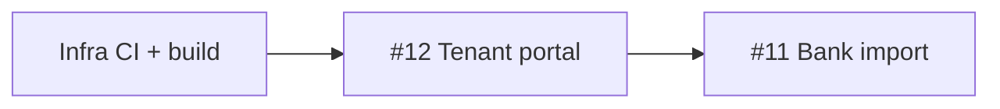

# Landlords — приоритеты (сентябрь 2026)

Сводка «что дальше» поверх [ROADMAP.md](./ROADMAP.md).  
Техдолг: [backend/TODO.md](../backend/TODO.md), [frontend/TODO.md](../frontend/TODO.md).

---

## Реализовано в ядре

Объекты, арендаторы, договоры (draft→active, renew/terminate), начисления/платежи/ledger, расходы по объекту, календарь, автонапоминания, документы и вложения, дашборд (ROI/forecast), credit score, onboarding, RBAC (owner/manager/accountant), UI-уведомления (#10), экспорт отчётов (#9), шаблоны договоров (#8).

---

## Сейчас — фундамент (до крупных фич)

| Задача | Где | Зачем |
|--------|-----|-------|
| Reproducible Docker (`pip install -r requirements.txt`, не `.venv` в образе) | `backend/Dockerfile` | Предсказуемые деплои |
| Полный CI | `.github/workflows/ci.yml` | lint → unit → **integration** → build image → frontend `tsc`/build |
| Зелёный frontend build | `frontend/TODO.md` P0 | `tsc` / `npm run build` без ошибок |

Volume `storage/documents` для api и celery — **готово** (`docker-compose.yml`).

---

## Продукт — рекомендуемый порядок

### 1. ~~Инвойсы / квитанции (#2)~~ — готово

PDF + публичная страница по токену, связка с charge, реквизиты в настройках аккаунта.

### 2. ~~Уведомления в UI (#10)~~ — готово

Колокольчик: просрочки и окончание договоров; dismiss. Failed reminder — после канала отправки.

### 3. ~~Экспорт отчётов (#9)~~ — готово

CSV/XLSX за период (`/reports`); листы платежи / начисления / расходы / сводка.

### 4. ~~Шаблоны договоров (#8)~~ — готово

Текст с `{{placeholders}}`, seed по типу объекта, CRUD в настройках, выбор при генерации PDF.

### 5. Дифференциаторы (дальше)

| # | Фича | Комментарий |
|---|------|-------------|
| 12 | Публичная страница арендатора | Отдельная auth-модель (magic link); хорошо стыкуется с инвойсами |
| 11 | Импорт выписки | Парсеры банков, много edge cases |
| 13 | Заявки на ремонт | Статусы → расходы |
| 14 | Мультивалюта / индексация | |
| 15 | Интеграции (Telegram, Calendar, 1С) | |

---

## Вне roadmap (пробелы)

- **Billing SaaS** — лендинг на waitlist; в CRM нет plans/subscription.
- **Аудит в UI** — contract events пишутся; owner не видит «кто что изменил» в интерфейсе.
- **Массовые операции** — generate/remind/export по нескольким договорам.
- **Каналы reminders** — SMS/Telegram без провайдера = половина фичи.

---

## Два стратегических пути

1. **B2B рантье / микро-УК** — invoices → notifications → export → templates → tenant portal. Быстрее к ежедневному использованию.
2. **Дифференциатор** — tenant portal (#12) раньше bank import. Сильнее на рынке, дольше и рискованнее без стабильного CI.
