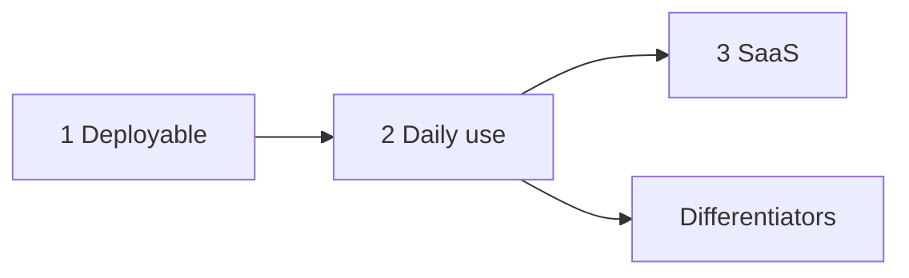

# Landlords — приоритеты (сентябрь 2026)

Короткий чеклист поверх стратегии в [ROADMAP.md](./ROADMAP.md).  
Инфра: [INFRA.md](./INFRA.md).  
Техдолг: [backend/TODO.md](../backend/TODO.md), [frontend/TODO.md](../frontend/TODO.md).  
Код (без rewrite): [backend/ARCHITECTURE.md](../backend/ARCHITECTURE.md).

---

## 1. Чтобы можно было задеплоить

| Задача | Где | Зачем |
|--------|-----|-------|
| Docker: online (`pip install`) **и** offline (`COPY .venv`) | `backend/Dockerfile`, [INFRA.md](./INFRA.md) | CI/чужая машина + твоя офлайн-сборка |
| Один вход: nginx → API + статика; без конфликта порта 80 | `docker-compose.yml`, `nginx/` | Прод-профиль взлетает |
| Секреты только из env; заполнить `.env.example` | `.env`, compose | Не дефолтные пароли |
| Полный CI: ruff → unit → integration → `tsc`/build → online image | `.github/workflows/ci.yml` | `git push` не пропускает красное |
| Зелёный frontend `tsc` | `frontend/TODO.md` | Честный UI-билд |
| Бэкап Postgres + `storage/documents`, runbook | [deploy.md](./deploy.md) | Можно откатить |
| Root README + демо-аккаунт | `README.md` | Вход через месяц |

Volume `storage/documents` для api и celery — **готово**.

После этого — VPS и пользование самому. Критерии «готово» — в [ROADMAP.md](./ROADMAP.md).

---

## 2. Чтобы чужой человек работал каждый день

| Задача | Комментарий |
|--------|-------------|
| ~~Реальная почта (SMTP)~~ | Готово: EmailService, Resend/`SMTP_*`, welcome/reset, Celery-письма owner |
| ~~Invite по ссылке~~ | Готово: invite link для manager/accountant; ссылка + статус отправки письма |
| ~~Публичная страница арендатора (**#12**)~~ | Готово: `/t/{token}`, баланс, история, квитанции, claim «я оплатил» |
| ~~Аудит в UI~~ | Готово: вкладка «События» на договоре (+ polish RBAC/пагинация) |
| ~~Массовые действия~~ | Готово: bulk generate + экспорт с `contract_ids` на списке договоров |
| ~~UX-долг~~ | Готово: Error Boundary; убран `ForecastWidget` и лишний `antd` |

Импорт выписки (**#11**) — после почты и #12.

---

## 3. Чтобы это был SaaS

| Задача | Комментарий |
|--------|-------------|
| Тарифы и лимиты | Объекты, пользователи, хранилище (plans/subscription) |
| Оплата | Stripe или ЮKassa, webhooks, отключение при неоплате |
| Юридическое | Оферта, политика данных, удаление аккаунта, выгрузка |
| Наблюдаемость | Sentry + алерты на beat и диск документов |
| Поддержка | Почта «написать нам», статус инцидентов |

---

## Не сейчас

Мультивалюта (**#14**), заявки на ремонт (**#13**), Google Calendar / 1С / мобильное приложение (**#15** без Telegram как канала напоминаний). Не двигают «можно пользоваться».

---

## Связанные спеки

- Стратегия и критерии: [ROADMAP.md](./ROADMAP.md)
- Инфра: [INFRA.md](./INFRA.md)
- Деньги: [MONEY_FLOW.md](./MONEY_FLOW.md), [use-cases-contracts-payments.md](./use-cases-contracts-payments.md)
- Роли: [multi-user-roles.md](./multi-user-roles.md)
