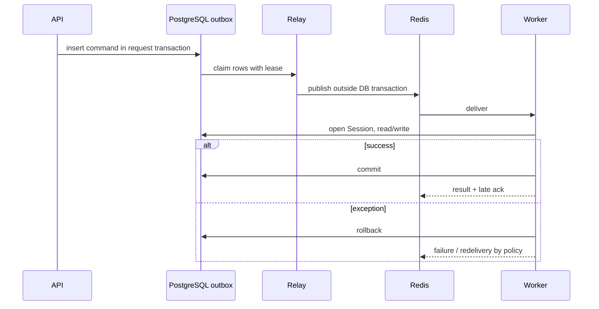

# Celery, Redis и фоновые задачи

## Конфигурация

`backend/app/celery_app.py` создаёт Celery app. Redis (`REDIS_URL`) одновременно
является broker и result backend. Entry point worker/beat/Flower:
`python -m celery -A worker.celery_app ...`; `backend/worker.py` re-export-ит
app.

Глобальные параметры:

- очередь: `CELERY_TASK_DEFAULT_QUEUE` (default `default`), отдельной routing
  table нет;
- JSON serializer, UTC;
- soft/hard limits по умолчанию 300/600 секунд;
- `task_acks_late=True`, `task_reject_on_worker_lost=True`;
- `task_track_started=True`;
- worker recycle после `CELERY_WORKER_MAX_TASKS_PER_CHILD` (default 1000).

Late ack означает возможное повторное выполнение после потери worker. Это
доставка at-least-once, не exactly-once.

## Расписание

| UTC | Task | Назначение |
|---|---|---|
| ежедневно 03:00 | `update_overdue_charges` | Статусы начислений и договоров |
| ежедневно 04:00 | `process_subscription_renewals` | Renew/downgrade Pro |
| ежедневно 07:00 | `send_daily_reminder_emails` | Письма owner |
| каждый час на `:15` | `check_ops_health` | Диск, gauges, beat heartbeat |

Beat schedule находится только в коде; persistent scheduler database не
настроена.

## Tasks и гарантии

### `generate_charges_for_contract(account_id, contract_id, outbox_id)`

Создаёт repositories/session, вызывает `RentChargeService.create_charges_batch`,
и обновляет `task_outbox.completed_at` в одной транзакции. Завершённый outbox ID
делает повтор no-op; уникальность периода
`(account_id, contract_id, period_start, period_end)` дополнительно защищает
финансовые записи. Старые Redis messages без `outbox_id` временно обрабатываются
как legacy deliveries до drain очереди.

### Transactional outbox

Bulk/single charge-generation endpoints и активация договора записывают
allow-listed `generate_charges_for_contract` command в `task_outbox` внутри
request transaction. HTTP возвращает UUID outbox как стабильный Celery `task_id`.
Отдельный Compose process `outbox-relay` использует bounded
`FOR UPDATE SKIP LOCKED` claims и expiring leases, затем публикует вне DB
transaction. Broker failure получает ограниченный exponential backoff с
jitter; после лимита запись сохраняется как terminal failure.

Публикация at-least-once, не exactly-once: падение relay после publish может
создать duplicate delivery. Worker сверяет account/contract scope, а бизнес
эффект и completion marker коммитит атомарно. Если Redis теряет queued message,
не завершённая строка становится доступна после lease и будет опубликована
снова. Relay пишет в лог pending count, возраст старейшей команды и число
terminal failures; payload и credentials в лог не попадают.

### Bulk tasks

`update_overdue_charges`, `send_daily_reminder_emails` и
`process_subscription_renewals` используют `RedisLock("locks:<name>")` с TTL
900 секунд и non-blocking acquire. Если lock занят, task возвращает
`status=skipped`. Lock уменьшает параллельный запуск, но истечение TTL во время
долгой операции допускает overlap.

`update_overdue_charges` повторяется только при SQLAlchemy `OperationalError`
(максимум 3 раза). `send_daily_reminder_emails` повторяется при
`OperationalError`, `SMTPServerDisconnected`, `socket.timeout`,
`ConnectionError` и агрегированной `TransientEmailDeliveryError` (максимум 2
раза). `process_subscription_renewals` повторяется только при
`OperationalError` (максимум 2 раза). Остальные исключения не повторяются
автоматически.

Email dedup дополнительно хранится в `email_dispatch_log`. Billing renewal
использует `accounts.subscription_period_end` как identity оплачиваемого
периода, время первой попытки, детерминированный idempotence key, статус и
YooKassa payment ID. Попытка коммитится до HTTP вызова. Перед новым запросом и
восстановлением клиент ищет совпадение по metadata периода во всех страницах
списка платежей; найденный ID сверяется через `Payment.find_one`. Если поиск
не сработал, период остаётся `unknown`, повторное списание не создаётся.
Webhook/confirm читают состояние у YooKassa и блокируют account row при
применении entitlement. Повторные запуски ограничены декораторами задач:
произвольные исключения и бизнес-ошибки не ретраятся, а временные ошибки
перечислены отдельно для каждой задачи выше.

### Ops heartbeat

Tasks записывают `ops:beat:last_ok` в Redis. Alert dedup использует ключи
`ops:alert:dedup:<alert_key>` с TTL. Это cache/operational state, а не durable
business data; очистка Redis теряет heartbeat, locks, dedup и Celery results.

## Жизненный цикл



Команда начислений сначала фиксируется в `task_outbox` вместе с HTTP-изменением.
Relay забирает запись lease-ом и публикует её в Redis после завершения короткой
транзакции PostgreSQL. Поэтому сбой после commit не теряет команду: relay
повторит публикацию после lease/backoff. Сбой после успешной публикации, но до
фиксации её состояния может дать повторную доставку; worker обрабатывает её
идемпотентно по `outbox_id`. Outbox обеспечивает надёжную передачу команды, но
не exactly-once delivery. Этот механизм применяется к генерации начислений;
другие Celery flows имеют собственные гарантии.

Endpoints генерации возвращают Celery `task_id`, но отдельного API для чтения
состояния result backend нет. Клиент проверяет результат повторным чтением
business resource, а не polling task state.

## Эксплуатация

```bash
docker compose ps
docker compose logs celery-worker celery-beat
docker compose --profile development up -d flower
docker compose exec celery-worker \
  python -m celery -A worker.celery_app inspect active
docker compose exec celery-worker \
  python -m celery -A worker.celery_app inspect scheduled
```

Flower включён только profile `development` и не публикует порт в базовом
Compose. Worker healthcheck проверяет соединение с broker, но не выполнение
task; у beat/Flower healthcheck отключён. Для stale beat используются
`OPS_BEAT_STALE_HOURS` и `/ready`, при этом stale heartbeat намеренно не делает
readiness unhealthy.

## Изменение task

Проверяйте transaction boundary, повторное выполнение, account isolation,
retryable exception types, limits, lock TTL и логи без чувствительных данных.
Тесты tasks находятся в `backend/tests/tasks/`.
