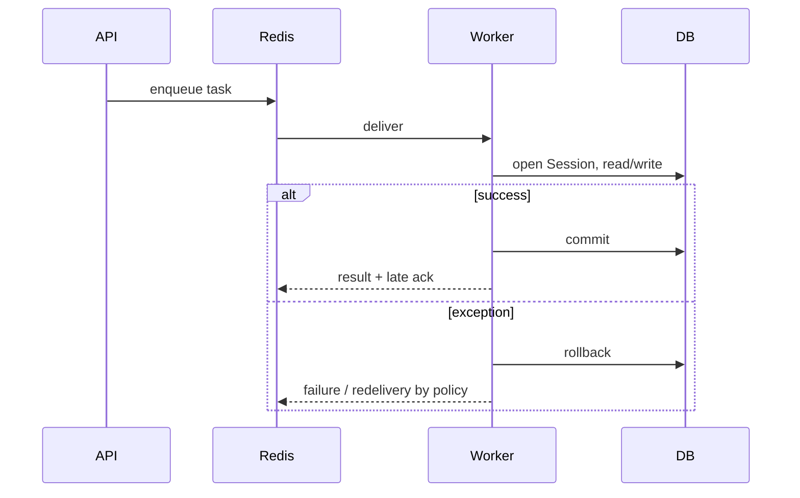

# Celery, Redis и фоновые задачи

## Конфигурация

`backend/app/celery_app.py` создаёт Celery app. Redis (`REDIS_URL`) одновременно
является broker и result backend. Entry point worker/beat/Flower:
`python -m celery -A worker.celery_app ...`; `backend/worker.py` re-export-ит
app.

Глобальные параметры:

- очередь: `CELERY_TASK_DEFAULT_QUEUE` (default `default`), отдельной routing
  table нет;
- JSON serializer, UTC;
- soft/hard limits по умолчанию 300/600 секунд;
- `task_acks_late=True`, `task_reject_on_worker_lost=True`;
- `task_track_started=True`;
- worker recycle после `CELERY_WORKER_MAX_TASKS_PER_CHILD` (default 1000).

Late ack означает возможное повторное выполнение после потери worker. Это
доставка at-least-once, не exactly-once.

## Расписание

| UTC | Task | Назначение |
|---|---|---|
| ежедневно 03:00 | `update_overdue_charges` | Статусы начислений и договоров |
| ежедневно 04:00 | `process_subscription_renewals` | Renew/downgrade Pro |
| ежедневно 07:00 | `send_daily_reminder_emails` | Письма owner |
| каждый час на `:15` | `check_ops_health` | Диск, gauges, beat heartbeat |

Beat schedule находится только в коде; persistent scheduler database не
настроена.

## Tasks и гарантии

### `generate_charges_for_contract(account_id, contract_id)`

Создаёт repositories/session, вызывает `RentChargeService.create_charges_batch`,
commit. Повтор должен быть безопасен за счёт проверки существующих периодов в
service/repository, но отдельного task idempotency key или DB unique constraint
на период в модели не обнаружено. Retry только для SQLAlchemy
`OperationalError`, максимум 3, с backoff; task limits 120/180 секунд.

### Bulk tasks

`update_overdue_charges`, `send_daily_reminder_emails` и
`process_subscription_renewals` используют `RedisLock("locks:<name>")` с TTL
600 секунд и non-blocking acquire. Если lock занят, task возвращает
`status=skipped`. Lock уменьшает параллельный запуск, но истечение TTL во время
долгой операции допускает overlap.

Email dedup дополнительно хранится в `email_dispatch_log`. Billing полагается на
состояние account/YooKassa. У bulk email и overdue tasks нет ограниченного
`autoretry_for`: исключение завершает текущий запуск; retry policy Celery
декоратором для них фактически не включена.

### Ops heartbeat

Tasks записывают `ops:beat:last_ok` в Redis. Alert dedup использует ключи
`ops:alert:<key>` с TTL. Это cache/operational state, а не durable business
data; очистка Redis теряет heartbeat, locks, dedup и Celery results.

## Жизненный цикл



HTTP enqueue не образует атомарную транзакцию с PostgreSQL (outbox отсутствует).
Сбой между DB commit и publish либо между publish и HTTP response может дать
пропуск/дубликат; use cases должны оставаться повторяемыми.

## Эксплуатация

```bash
docker compose ps
docker compose logs celery-worker celery-beat
docker compose --profile development up -d flower
docker compose exec celery-worker \
  python -m celery -A worker.celery_app inspect active
docker compose exec celery-worker \
  python -m celery -A worker.celery_app inspect scheduled
```

Flower включён только profile `development` и не публикует порт в базовом
Compose. Worker healthcheck проверяет соединение с broker, но не выполнение
task; у beat/Flower healthcheck отключён. Для stale beat используются
`OPS_BEAT_STALE_HOURS` и `/ready`, при этом stale heartbeat намеренно не делает
readiness unhealthy.

## Изменение task

Проверяйте transaction boundary, повторное выполнение, account isolation,
retryable exception types, limits, lock TTL и логи без чувствительных данных.
Тесты tasks находятся в `backend/tests/tasks/`.
