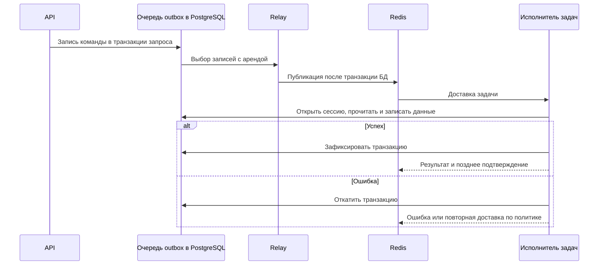

# Celery, Redis и фоновые задачи

## Конфигурация

`backend/app/celery_app.py` создаёт приложение Celery. Redis (`REDIS_URL`)
одновременно используется как брокер сообщений и хранилище результатов.
Команды запуска исполнителя задач (worker), планировщика (beat) и Flower:
`python -m celery -A worker.celery_app ...`; модуль `backend/worker.py`
повторно экспортирует приложение.

Основные параметры:

- очередь по умолчанию задаётся через `CELERY_TASK_DEFAULT_QUEUE` (значение по
  умолчанию — `default`); отдельная таблица маршрутизации не настроена;
- сериализатор — JSON, часовой пояс — UTC;
- мягкий и жёсткий лимиты времени задачи по умолчанию — 300 и 600 секунд;
- `task_acks_late=True`, `task_reject_on_worker_lost=True`;
- `task_track_started=True`;
- исполнитель перезапускает дочерний процесс после количества задач,
  указанного в `CELERY_WORKER_MAX_TASKS_PER_CHILD` (по умолчанию 1000).

Подтверждение задачи после её выполнения означает, что при потере процесса
исполнителя задача может выполниться повторно. Это доставка «как минимум один
раз» (at-least-once), а не доставка «ровно один раз» (exactly-once).

## Расписание

| UTC | Задача | Назначение |
|---|---|---|
| ежедневно 03:00 | `update_overdue_charges` | Обновление статусов начислений и договоров |
| ежедневно 04:00 | `process_subscription_renewals` | Продление подписки или переход Pro на другой план |
| ежедневно 07:00 | `send_daily_reminder_emails` | Отправка писем владельцам |
| каждый час в `:15` | `check_ops_health` | Проверка диска, метрик и heartbeat beat |

Расписание beat хранится в коде; отдельная база планировщика не используется.

## Задачи и гарантии

### `generate_charges_for_contract(account_id, contract_id, outbox_id)`

Задача создаёт репозитории и сессию, вызывает
`RentChargeService.create_charges_batch` и обновляет `task_outbox.completed_at`
в одной транзакции. При повторной обработке `outbox_id` задача ничего не делает.
Уникальность периода `(account_id, contract_id, period_start, period_end)`
дополнительно защищает финансовые записи. Старые сообщения Redis без
`outbox_id` временно обрабатываются как устаревшие доставки, пока очередь не
будет опустошена.

### Транзакционный outbox

Маршруты одиночной и пакетной генерации начислений, а также активация договора
записывают разрешённую команду `generate_charges_for_contract` в `task_outbox`
внутри транзакции запроса. HTTP-ответ возвращает UUID outbox как стабильный
Celery `task_id`.

Отдельный процесс Compose `outbox-relay` выбирает ограниченную пачку записей с
`FOR UPDATE SKIP LOCKED` и временной арендой (lease), затем публикует команды
после завершения транзакции базы данных. При ошибке брокера запись получает
ограниченные повторы с экспоненциальной задержкой (backoff) и случайным
интервалом (jitter). После исчерпания попыток запись получает конечный статус
ошибки.

Публикация выполняется по модели «как минимум один раз» (at-least-once), а не
«ровно один раз» (exactly-once): если relay завершится после публикации, но до
фиксации результата, возможна повторная доставка. Исполнитель проверяет
соответствие `account_id` и `contract_id`, а затем
атомарно сохраняет бизнес-изменения вместе с отметкой завершения. Если Redis
теряет сообщение из очереди, незавершённая запись снова становится доступна
после окончания lease и публикуется повторно. Relay записывает в лог количество
ожидающих команд, возраст самой старой команды и число конечных ошибок; данные
команд и учётные данные в лог не попадают.

### Пакетные задачи

`update_overdue_charges`, `send_daily_reminder_emails` и
`process_subscription_renewals` используют `RedisLock("locks:<name>")` с TTL
900 секунд и неблокирующим захватом. Hard time limit задачи составляет 600
секунд, поэтому TTL блокировки длиннее максимального времени выполнения. Если блокировка занята, задача возвращает
`status=skipped`. Блокировка предотвращает параллельный запуск, однако при
истечении TTL во время долгой операции возможно одновременное выполнение двух
экземпляров.

`update_overdue_charges` повторяется только при SQLAlchemy `OperationalError`
(не более 3 попыток). `send_daily_reminder_emails` повторяется при
`OperationalError`, `SMTPServerDisconnected`, `socket.timeout`,
`ConnectionError` и агрегированной `TransientEmailDeliveryError` (не более 2
попыток). `process_subscription_renewals` повторяется только при
`OperationalError` (не более 2 попыток). Остальные исключения автоматически не
повторяются.

Дедупликация писем хранится в `email_dispatch_log`. Для продления подписки
используются `accounts.subscription_period_end` как идентификатор расчётного
периода, время первой попытки, детерминированный ключ идемпотентности, статус и
ID платежа YooKassa. Попытка сохраняется до HTTP-вызова. Перед новым запросом и
восстановлением состояния клиент ищет совпадение по метаданным периода во всех
страницах списка платежей; найденный ID проверяется через `Payment.find_one`.
Если поиск не дал результата, период остаётся в статусе `unknown`, новое
списание не создаётся. Webhook и confirm получают состояние платежа из YooKassa
и блокируют строку учётной записи при применении прав тарифа. Повторные запуски
задаются декораторами задач: произвольные исключения и бизнес-ошибки не
повторяются, а временные ошибки перечислены отдельно для каждой задачи выше.

### Отметки активности фоновых задач

Задачи записывают отметку активности `ops:beat:last_ok` в Redis. Для
дедупликации оповещений используются ключи `ops:alert:dedup:<alert_key>` с TTL.
Это временное состояние
работы системы, а не долговременные бизнес-данные: очистка Redis удалит
отметки активности, блокировки, отметки дедупликации и результаты Celery.

Все Celery tenant-транзакции устанавливают `app.account_id` до чтения и записи.
Пакетные задачи перечисляют account ID и обрабатывают каждый аккаунт в отдельном
контексте. Outbox relay также обходит аккаунты по одному. Узкие PostgreSQL
resolver-функции возвращают только account ID для активных capability-токенов и
пакетной обработки; их владелец — отдельная `NOLOGIN` роль с `BYPASSRLS` и
column-level `SELECT`, а runtime-роль имеет только `EXECUTE` и не состоит в этой
роли.

## Жизненный цикл



Команда начислений сначала записывается в `task_outbox` вместе с изменением,
выполненным через HTTP. Relay забирает запись во временную аренду и публикует её
в Redis после завершения короткой транзакции PostgreSQL. Поэтому сбой после
фиксации транзакции не теряет команду: после окончания аренды или задержки
повтора relay опубликует её снова. Сбой после публикации, но до сохранения
результата может привести к повторной доставке; исполнитель обрабатывает её
идемпотентно по `outbox_id`. Outbox обеспечивает надёжную передачу команды, но
не гарантирует доставку «ровно один раз» (exactly-once). Этот механизм
применяется к генерации начислений; остальные фоновые процессы используют
собственные гарантии.

Маршруты генерации возвращают Celery `task_id`, но отдельного API для чтения
результатов хранилища нет. Клиент проверяет результат повторным чтением
бизнес-данных, а не опрашивает состояние задачи.

## Эксплуатационные команды

```bash
docker compose ps
docker compose logs celery-worker celery-beat
docker compose --profile development up -d flower
docker compose exec celery-worker \
  python -m celery -A worker.celery_app inspect active
docker compose exec celery-worker \
  python -m celery -A worker.celery_app inspect scheduled
```

Flower включён только в профиль `development` и не публикует порт в базовой
конфигурации Compose. Просроченная отметка beat отслеживается настройкой
`OPS_BEAT_STALE_HOURS` и endpoint `/ready`; сам по себе он не переводит readiness
в нездоровое состояние.

## Healthchecks и метрики

Compose проверяет, что worker отвечает на `celery inspect ping`, beat-процесс
присутствует в `/proc`, а outbox relay обновлял Redis heartbeat в последние
120 секунд. Проверки запускаются раз в 30 секунд; для beat и relay установлен
30-секундный период перед первой проверкой. Это состояние Docker healthcheck:
`restart: unless-stopped` перезапускает завершившийся процесс, но само по себе
не перезапускает контейнер только из-за статуса `unhealthy`.

API `/metrics` экспортирует события только для фиксированного списка встроенных
задач (`started`, `success`, `failure`, `skipped`). В labels нет tenant/user ID,
email, аргументов, task ID или URL. Prometheus и exporters доступны только во
внутренней сети Compose; nginx не проксирует endpoint метрик.

Prometheus alerts отмечают недоступные scrape targets, свободное место на
корневом разделе ниже 10% или в хранилище документов ниже 500 MiB, отсутствие
успешной часовой проверки более двух часов, stale relay heartbeat, не менее трёх
ошибок одной задачи за 15 минут и терминальные ошибки outbox. `for` интервалы
задерживают срабатывание при кратковременных перезапусках. Daily задачи не
имеют отдельного механизма backfill всех пропущенных запусков. После простоя
Celery beat может поставить одну просроченную итерацию каждого due schedule;
проверь результат и вручную обработай интервалы, которые не покрыла эта
итерация.

App-level disk/beat checks продолжают отправлять письмо на `SUPPORT_EMAIL` и
событие в Sentry при заданном `SENTRY_DSN`. Alertmanager пока только группирует
Prometheus alerts: внешний email/webhook receiver не настроен, поэтому эти
alerts сами по себе не доставляются оператору. Настройте receiver до того, как
использовать их как канал уведомлений.
