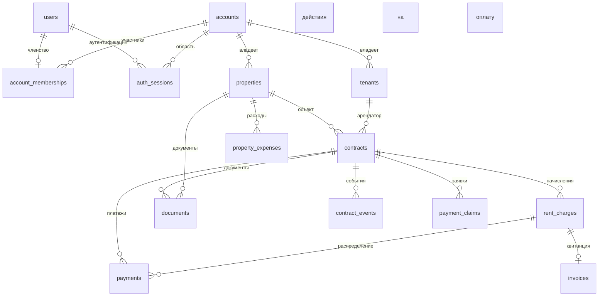

# База данных и транзакции

## Стек и миграции

Используются PostgreSQL 15, SQLAlchemy 2 в синхронном режиме, psycopg2 и
Alembic. Движок SQLAlchemy и `SessionLocal` создаются в
`backend/app/db/session.py`.
`DATABASE_URL` собирается из `DB_*` в `app/core/config.py`.

Схему определяют миграции `backend/alembic/versions/`; ORM-модели не заменяют
миграции. Применение:

```bash
cd backend
alembic current
alembic upgrade head
```

В Compose миграции выполняет `backend/docker-entrypoint.sh` только для `api`
при `RUN_MIGRATIONS=1`. Автоматического отката схемы нет: downgrade следует
проверять отдельно, а восстановление данных выполнять по
[deploy.md](../deploy.md).

## Владение данными

`accounts` задаёт границу между аккаунтами. Большинство бизнес-таблиц содержит
`account_id`; запросы репозиториев на чтение, изменение и удаление должны
учитывать это поле. JWT содержит `account_id`, а зависимость дополнительно
проверяет активное членство в `account_memberships`. Изоляция выполняется на
уровне приложения; Row Level Security (RLS) в PostgreSQL не настроен.



## Основные таблицы

| Группа | Таблицы | Назначение |
|---|---|---|
| Пользователи и аккаунты | `users`, `accounts`, `account_memberships`, `account_invites`, `auth_sessions` | Пользователи, аккаунты, роли, приглашения, одноразовый ID токена сброса пароля, отзываемые JWT-сессии |
| Аренда | `properties`, `tenants`, `contracts`, `contract_templates` | Объекты, арендаторы и договоры; токен портала хранится с двухчасовым сроком действия |
| Финансы | `rent_charges`, `payments`, `property_expenses`, `invoices`, `payment_claims` | Начисления, платежи, расходы, публичные квитанции и заявки на оплату |
| Документы | `documents` | Метаданные файлов; содержимое хранится на диске |
| Операции | `reminders`, `email_dispatch_log`, `notification_dismissals`, `task_outbox` | Дедупликация, пользовательские состояния и долговременные команды фоновых задач |
| Аудит | `contract_events`, `audit_logs`, `feedback` | История событий и обратная связь |

Для `account_memberships` заданы ограничения уникальности `(account_id, user_id)`
и `user_id`, поэтому схема допускает только один аккаунт на пользователя.
Внешние ключи обычно используют `CASCADE`; для связей договоров с объектом или
арендатором и платежей с договором применяется `RESTRICT`, а для необязательной
связи платежа с начислением — `SET NULL`. Точные ограничения следует проверять
по миграциям, а не по аннотациям модели.

## Деньги

ORM и доменный слой используют `Decimal`; API должен сериализовать денежные
значения строками. `rent_charges` создают обязательство, `payments` уменьшают его.
`payments.rent_charge_id` допускает `NULL`: отсутствие ссылки означает аванс;
сервис распределяет его по FIFO. Депозит — поле договора и не входит в ledger.
Полные инварианты: [money-flow.md](../money-flow.md).

## Индексы

Есть отдельные индексы на поля аккаунтов и внешних ключей, а также составные
индексы:

- `contracts`: `(property_id, status)`, `(account_id, status)`;
- `rent_charges`: `(contract_id, status)`, `(due_date, status)`,
  `(account_id, status)`; уникальный идентификатор периода
  `(account_id, contract_id, period_start, period_end)`;
- `payments`: `(contract_id, date_paid)`;
- `property_expenses`: `(property_id, date_incurred)`;
- `auth_sessions`: первичный ключ `id` для проверки активной сессии, индекс
  `expires_at` для очистки.

Наличие индексов подтверждено моделями и миграциями, но планы запросов и
фактическая наполненность production-базы в репозитории не зафиксирована.

## Транзакции и конкурентность

- HTTP: `get_db_session` фиксирует или откатывает транзакцию всего запроса.
- Celery: задача создаёт `SessionLocal` и явно фиксирует или откатывает транзакцию.
- Запись outbox для генерации начислений создаётся вместе с изменением из
  запроса; relay выбирает ограниченную пачку записей с временной арендой, но
  публикует их в Redis после фиксации выбора. Начисления и отметка завершения
  outbox фиксируются одной транзакцией задачи.
- Пакетные задачи по расписанию используют блокировки Redis с TTL 600 секунд.
- Генерация начислений защищена ограничением уникальности
  `(account_id, contract_id, period_start, period_end)` и PostgreSQL
  `ON CONFLICT DO NOTHING`. Миграция проверяет существующие дубли и отказывает
  в upgrade без удаления финансовых строк.
- Платёжные операции блокируют строки в следующем порядке: договор, начисления
  по дате оплаты, авансовые платежи по дате и времени создания. Это
  последовательно выполняет изменения платежей и распределение авансов внутри
  договора.
- Продление SaaS-подписки сохраняет в `accounts` период, время первой попытки,
  ключ идемпотентности, статус и ID платежа провайдера. Перед новым запросом или
  восстановлением состояния список YooKassa сверяется по метаданным периода.
  Попытка фиксируется до HTTP-запроса, поэтому внешний вызов не удерживает
  транзакцию или блокировку строки в БД.
- Интеграционные тесты создают отдельную базу `landlords_test`, применяют
  последнюю миграцию Alembic и удаляют базу после завершения сессии тестов.
