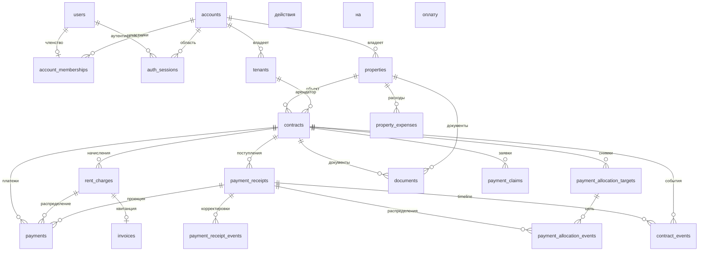

# База данных и транзакции

## Стек и миграции

Используются PostgreSQL 15, SQLAlchemy 2 в синхронном режиме, psycopg2 и
Alembic. Движок SQLAlchemy и `SessionLocal` создаются в
`backend/app/db/session.py`.
`DATABASE_URL` собирается из рабочих `DB_*`; `MIGRATION_DATABASE_URL` — из `MIGRATION_DB_*` в `app/core/config.py`. Рабочая роль не владеет таблицами и не имеет `BYPASSRLS`; миграции и выдача grants выполняются одноразовыми сервисами с отдельными credentials.

Для узких `SECURITY DEFINER` resolver-функций используется отдельная роль
`landlords_rls_resolver`: `NOLOGIN`, без `SUPERUSER` и DDL-привилегий, с
`BYPASSRLS` и column-level `SELECT` только на данных, нужных функциям. Владельцем
этих функций является resolver-роль; API/worker не являются её участниками и
получают только `EXECUTE`. Bootstrap этой роли требует migration admin с
superuser-привилегией PostgreSQL.

Схему определяют миграции `backend/alembic/versions/`; ORM-модели не заменяют
миграции. Применение:

```bash
cd backend
alembic current
alembic upgrade head
```

В Compose одноразовый сервис `db-migrate` запускает `backend/docker-entrypoint.sh` с `RUN_MIGRATIONS=1` после `db-role-bootstrap`; API и Celery получают только credentials рабочей роли. Автоматического отката схемы нет: downgrade следует
проверять отдельно, а восстановление данных выполнять по
[deploy.md](../deploy.md).

## Владение данными

`accounts` задаёт границу между аккаунтами. Большинство бизнес-таблиц содержит
`account_id`; запросы репозиториев на чтение, изменение и удаление должны
учитывать это поле. JWT содержит `account_id`, а зависимость дополнительно
проверяет активное членство в `account_memberships`. PostgreSQL RLS включён и
принудительно применяется к tenant-таблицам, включая `accounts` (по `id`) и
`audit_logs` (с отдельным `account_id`). Таблица `users` остаётся глобальной для
поиска identity и входа.

Каждая транзакция с данными аккаунта должна установить UUID через
`set_tenant_context(session, account_id)`. Вспомогательная функция задаёт transaction-local
`set_config('app.account_id', ..., true)`: после commit/rollback контекст не
переходит на следующую транзакцию из пула. Политики запрещают доступ при пустом или
неустановленном значении. Репозитории сохраняют `account_id` фильтры как второй
уровень защиты; RLS не отменяет прикладную авторизацию или проверку membership.

Публичные ссылки с токеном и глобальные Celery-задачи требуют отдельно
определить аккаунт до запросов его данным; см. [background-jobs.md](background-jobs.md).
Функция возвращает только ID аккаунта; последующие запросы выполняются обычной
runtime-ролью под RLS. Не выдавать `BYPASSRLS` runtime-роли.



## Основные таблицы

| Группа | Таблицы | Назначение |
|---|---|---|
| Пользователи и аккаунты | `users`, `accounts`, `account_memberships`, `account_invites`, `auth_sessions` | Пользователи, аккаунты, роли, приглашения, одноразовый ID токена сброса пароля, отзываемые JWT-сессии |
| Аренда | `properties`, `tenants`, `contracts`, `contract_templates` | Объекты, арендаторы и договоры; токен портала хранится с двухчасовым сроком действия |
| Финансы | `rent_charges`, `payments`, `payment_receipts`, `payment_receipt_events`, `payment_allocation_targets`, `payment_allocation_events`, `property_expenses`, `invoices`, `payment_claims` | Начисления, совместимая проекция платежей, неизменяемые поступления и история корректировок/распределений |
| Документы | `documents` | Метаданные файлов; содержимое хранится на диске |
| Операции | `reminders`, `email_dispatch_log`, `notification_dismissals`, `task_outbox`, `payment_idempotency_records` | Дедупликация, пользовательские состояния и долговременные команды фоновых задач; snapshot ручных платежей |
| Аудит | `contract_events`, `audit_logs` (с `account_id`), `feedback` | История событий и обратная связь; новые payment events имеют FK на receipt |

Для `account_memberships` заданы ограничения уникальности `(account_id, user_id)`
и `user_id`, поэтому схема допускает только один аккаунт на пользователя.
Внешние ключи обычно используют `CASCADE`; для связей договоров с объектом или
арендатором и платежей с договором применяется `RESTRICT`, а для необязательной
связи платежа с начислением — `SET NULL`. Точные ограничения следует проверять
по миграциям, а не по аннотациям модели.

## Деньги

ORM и доменный слой используют `Decimal`; API должен сериализовать денежные
значения строками. `rent_charges` создают обязательство, `payments` уменьшают его.
`payments.rent_charge_id` допускает `NULL`: отсутствие ссылки означает аванс;
сервис распределяет его по FIFO. Депозит — поле договора и не входит в ledger.
Полные инварианты: [money-flow.md](../money-flow.md).

Новые поступления записываются в неизменяемую `payment_receipts`; её исходная
сумма, источник (`manual` или `tenant_claim`) и остальные исходные поля не
редактируются. `payment_receipt_events` хранит знаковые изменения суммы и снимок
исправленных полей. `payment_allocation_events` хранит положительные события
распределения и отрицательные компенсации со ссылкой на обращаемое событие.
`payment_allocation_targets` хранит неизменяемый снимок начисления при первом
новом распределении, поэтому allocation остаётся разрешимым, если завершение
договора удалит строку из `rent_charges`. В `payments` новые строки получают `receipt_id`; связанная
проекция также получает `allocation_event_id`. `contract_events.payment_receipt_id`
ссылается на стабильное поступление, а старое JSON metadata поле сохраняется.

Миграция не делает backfill финансовых фактов. У прежних строк
`payments.receipt_id IS NULL` означает `legacy/unknown`: старые split-группы,
удалённые/изменённые суммы и распределения нельзя доказать по текущей схеме.
Снимок в `payment_allocation_targets` создаётся транзакционно при первой новой
allocation, в том числе если само начисление существовало до миграции. Миграция
проверяет, что DDL не изменил число и сумму платежей, contract events и JSON
payment refs.
Downgrade отказывает при наличии новой receipt/allocation history или FK-ссылок;
при откате приложения additive schema остаётся доступной старому коду.

## Индексы

Есть отдельные индексы на поля аккаунтов и внешних ключей, а также составные
индексы:

- `contracts`: `(property_id, status)`, `(account_id, status)`;
- `rent_charges`: `(contract_id, status)`, `(due_date, status)`,
  `(account_id, status)`; уникальный идентификатор периода
  `(account_id, contract_id, period_start, period_end)`;
- `payments`: `(contract_id, date_paid)`;
- `property_expenses`: `(property_id, date_incurred)`;
- `auth_sessions`: первичный ключ `id` для проверки активной сессии, индекс
  `expires_at` для очистки.

## Транзакции и конкурентность

- HTTP: `get_db_session` фиксирует или откатывает транзакцию всего запроса; до tenant-запросов устанавливается transaction-local RLS context.
- Для `POST /v1/payments` reservation ключа, платежи, события договора и JSON snapshot ответа фиксируются в этой же HTTP-транзакции. Уникальность `(account_id, operation_scope, key)` сериализует повторные запросы; при одинаковом запросе возвращается сохранённый ответ, при другом — конфликт. TTL составляет 24 часа, просроченные записи аккаунта очищаются при следующем запросе с ключом.
- Celery: задача создаёт `SessionLocal`, устанавливает tenant context и явно фиксирует или откатывает транзакцию.
- Запись outbox для генерации начислений создаётся вместе с изменением из
  запроса; relay выбирает ограниченную пачку записей с временной арендой, но
  публикует их в Redis после фиксации выбора. Начисления и отметка завершения
  outbox фиксируются одной транзакцией задачи.
- Пакетные задачи по расписанию используют блокировки Redis с TTL 900 секунд;
  hard time limit задачи — 600 секунд.
- Генерация начислений защищена ограничением уникальности
  `(account_id, contract_id, period_start, period_end)` и PostgreSQL
  `ON CONFLICT DO NOTHING`. Миграция проверяет существующие дубли и отказывает
  в upgrade без удаления финансовых строк.
- Платёжные операции блокируют строки в следующем порядке: договор, начисления
  по дате оплаты, авансовые платежи по дате и времени создания. Это
  последовательно выполняет изменения платежей и распределение авансов внутри
  договора. Receipt, projection rows, receipt corrections, allocation/reversal
  events и payment contract event записываются в одной транзакции. Новые
  traceability tables применяют tenant RLS; runtime роль может читать и
  добавлять финансовые факты, но не изменять и не удалять их.
- Продление SaaS-подписки сохраняет в `accounts` период, время первой попытки,
  ключ идемпотентности, статус и ID платежа провайдера. Перед новым запросом или
  восстановлением состояния список YooKassa сверяется по метаданным периода.
  Попытка фиксируется до HTTP-запроса, поэтому внешний вызов не удерживает
  транзакцию или блокировку строки в БД.
- Интеграционные тесты создают отдельную базу `landlords_test`, применяют
  последнюю миграцию Alembic и удаляют базу после завершения сессии тестов.
