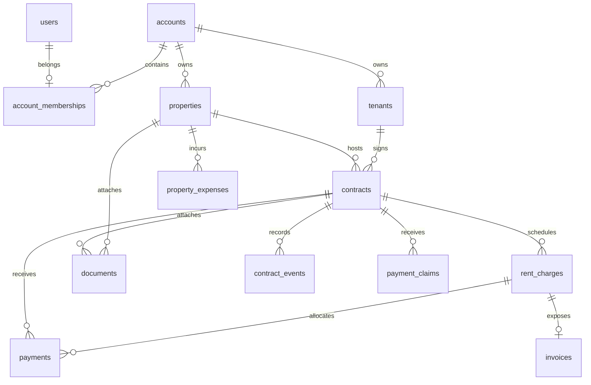

# База данных и транзакции

## Стек и миграции

Используются PostgreSQL 15, SQLAlchemy 2 в синхронном режиме, psycopg2 и
Alembic. Engine и `SessionLocal` создаются в `backend/app/db/session.py`.
`DATABASE_URL` собирается из `DB_*` в `app/core/config.py`.

Схему определяют миграции `backend/alembic/versions/`; ORM-модели не заменяют
миграции. Применение:

```bash
cd backend
alembic current
alembic upgrade head
```

В Compose миграции выполняет `backend/docker-entrypoint.sh` только для `api`
при `RUN_MIGRATIONS=1`. Автоматического rollback schema нет: downgrade следует
проверять отдельно, а восстановление данных выполнять по
[deploy.md](../deploy.md).

## Владение данными

`accounts` — tenant boundary. Большинство бизнес-таблиц содержат `account_id`;
repositories должны включать его в read/update/delete queries. JWT содержит
`account_id`, но dependency дополнительно проверяет активную
`account_memberships`. Это application-level изоляция: PostgreSQL Row Level
Security не настроен.



## Основные таблицы

| Группа | Таблицы | Назначение |
|---|---|---|
| Identity | `users`, `accounts`, `account_memberships`, `account_invites` | User, tenant account, роль, приглашения |
| Rental | `properties`, `tenants`, `contracts`, `contract_templates` | Объекты, арендаторы и договоры |
| Money | `rent_charges`, `payments`, `property_expenses`, `invoices`, `payment_claims` | Начисления, касса, расходы, публичные квитанции/claims |
| Documents | `documents` | Метаданные файлов; содержимое хранится на диске |
| Operations | `reminders`, `email_dispatch_log`, `notification_dismissals` | Дедупликация и пользовательские состояния |
| Audit | `contract_events`, `audit_logs`, `feedback` | История и обратная связь |

`account_memberships` имеет unique `(account_id, user_id)` и unique `user_id`,
поэтому текущая схема допускает только один account на user. Внешние ключи
обычно используют `CASCADE`; у contracts → property/tenant и payments →
contract применяется `RESTRICT`, у optional allocation — `SET NULL`.
Точные constraints необходимо проверять в миграциях, а не по аннотациям модели.

## Деньги

ORM/domain используют `Decimal`; API должен сериализовать денежные значения
строками. `rent_charges` создают обязательство, `payments` уменьшают его.
`payments.rent_charge_id` nullable: отсутствие ссылки означает аванс; сервис
распределяет его FIFO. Депозит — поле договора и не входит в ledger. Полные
инварианты: [MONEY_FLOW.md](../MONEY_FLOW.md).

## Индексы

Есть single-column indexes на tenant/FK-поля и составные индексы:

- contracts: `(property_id, status)`, `(account_id, status)`;
- rent charges: `(contract_id, status)`, `(due_date, status)`,
  `(account_id, status)`;
- payments: `(contract_id, date_paid)`;
- expenses: `(property_id, date_incurred)`.

Наличие индекса подтверждено моделями и миграциями, но планы запросов и
production cardinality в репозитории не зафиксированы.

## Транзакции и конкурентность

- HTTP: `get_db_session` commit/rollback на весь request.
- Celery: task создаёт `SessionLocal` и явно commit/rollback.
- Bulk scheduled tasks используют Redis locks с TTL 600 секунд.
- В коде нет общего optimistic version column или систематического
  `SELECT ... FOR UPDATE`; конкурентные мутации одного договора требуют
  отдельного анализа.
- Integration tests создают отдельную `landlords_test`, применяют Alembic head
  и удаляют БД после session.

## Процесс изменения схемы

1. Изменить ORM-модель и создать Alembic revision.
2. Проверить upgrade на копии актуальной схемы и, если применимо, downgrade.
3. Добавить/обновить integration test.
4. Обновить этот документ при изменении ownership, связей или transaction
   assumptions.
5. Не редактировать уже применённые production revisions.
