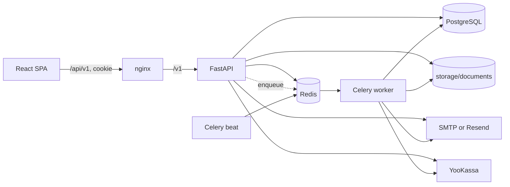

# Архитектура

## Контекст и компоненты

Landlords — модульный монолит: один FastAPI-процесс обслуживает API, отдельные
Celery worker/beat выполняют фоновые задачи, React SPA является клиентом. Это не
микросервисная система. PostgreSQL хранит бизнес-данные, Redis используется как
Celery broker/result backend, для distributed locks и ops heartbeat.



Runtime подтверждён `docker-compose.yml`, `nginx/nginx.conf`,
`backend/app/main.py` и `backend/app/celery_app.py`.

## Backend

Основное направление зависимостей:

```text
api/v1/routes → services → db/repositories → db/models
                     ↓              ↑
                  domain ← interfaces
```

- `app/main.py` создаёт FastAPI, подключает middleware, error handlers,
  health/metrics и routers.
- `app/api/v1/routes/` отвечает за HTTP, schemas и dependencies.
- `app/api/deps.py` строит repositories/services и проверяет текущую
  membership/RBAC.
- `app/services/` оркестрирует use cases; часть чистых правил находится в
  `app/domain/rules.py`.
- `app/db/repositories/` содержит SQLAlchemy queries и преобразование ORM ↔
  domain/DTO.
- `app/db/models/` и `alembic/` определяют сохраняемую схему.

Это слоистая архитектура с domain-элементами, но не строгая Clean/Hexagonal
Architecture: `services` знают concrete repositories, DI централизован в одном
модуле, а Celery tasks создают repositories напрямую.

## Жизненный цикл HTTP-запроса

1. nginx снимает `/api` и передаёт `/v1/...` в FastAPI.
2. `LoggingMiddleware` принимает/создаёт `X-Request-ID`, пишет request/response
   log и возвращает ID клиенту.
3. Pydantic валидирует path/query/body. Ошибка — HTTP 422 с `status=error`.
4. Protected route вызывает `get_current_membership`: JWT берётся из Bearer
   header или HttpOnly-cookie, затем user и membership повторно проверяются в
   БД. Роль берётся из БД.
5. `get_db_session` предоставляет одну sync SQLAlchemy Session. Repository и
   service используют её в рамках запроса.
6. После успешного выхода dependency выполняется `commit`; при исключении —
   `rollback`; затем Session закрывается.
7. `AppException` преобразуется в ожидаемую HTTP-ошибку, прочие исключения — в
   500 без выдачи внутренних деталей.

Транзакционная граница — HTTP-запрос, а не отдельный service. В Celery каждая
task самостоятельно создаёт Session и явно делает commit/rollback.

## Frontend

`frontend/src/` имеет FSD-подобную структуру:

- `app/` — router, providers, protected route;
- `pages/` — композиция экранов;
- `features/` — API adapters и feature components;
- `entities/` — TypeScript-типы;
- `shared/` — axios client, UI и utilities.

TanStack Query хранит server state, Zustand — auth state. Axios использует
`baseURL=/api/v1` и `withCredentials=true`. Старый token из `localStorage`
поддерживается только для миграции и удаляется после `/auth/me`.

## Синхронные и асинхронные границы

Активация/ручная генерация начислений ставит Celery task; ежедневные изменения
просрочек, письма, billing renewal и ops checks запускает beat. HTTP-ответ,
поставивший task, не гарантирует её успешное выполнение. Подробнее:
[background-jobs.md](background-jobs.md).

Внешние границы:

- SMTP или Resend SMTP — письма; без настройки non-production пишет файлы;
- YooKassa SDK — checkout, confirm, webhook verification и renewals;
- Sentry — опциональные ошибки/traces;
- локальная файловая система — документы, status incidents и dev-email.

## Ограничения и trade-offs

- Sync SQLAlchemy упрощает транзакции, но blocking I/O занимает worker thread.
- Один общий `deps.py` и крупные services/routes увеличивают связность.
- API и Celery совместно используют модели/services, но не общий unit of work.
- Файловое хранилище требует общего volume и не поддерживает горизонтальное
  масштабирование без shared filesystem/object storage.
- Миграции автоматически выполняет API на старте; несколько одновременно
  стартующих API replicas не предусмотрены.
- Полный перечень подтверждённых рисков находится в
  [technical-debt.md](../maintenance/technical-debt.md).
