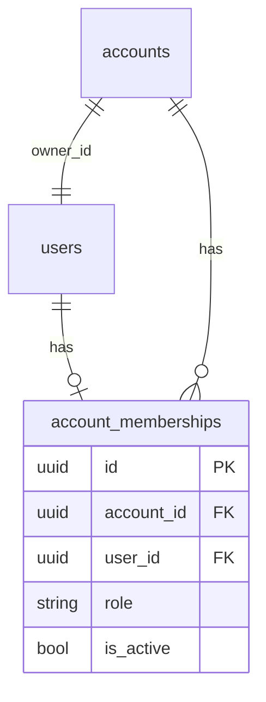

# Мультипользовательский аккаунт (роли)

Дизайн и решения по roadmap #6. Реализовано сентябрь 2026.

Связанные документы: [ROADMAP.md](./ROADMAP.md), [backend/ARCHITECTURE.md](../backend/ARCHITECTURE.md).

---

## Решения (зафиксировано)

- Роли: **owner / manager / accountant** с матрицей ниже.
- Участников создаёт owner вручную (email + full_name + role + пароль). **Без** invite-email и accept-flow.
- В v1: один user → одна membership (email уже занят → `ConflictError`).
- Без transfer ownership и без account switcher.
- Источник правды — backend; frontend только скрывает недоступные действия.
- UI и дашборд общие для всех ролей; отличаются права на мутации и блоки «Команда» / «Аккаунт» у owner.

## Матрица прав

| Возможность | owner | manager | accountant |
|---|---|---|---|
| Команда (добавить/сменить роль/удалить) | да | нет | нет |
| Настройки аккаунта / удаление аккаунта | да | нет | нет |
| Объекты, арендаторы, договоры, документы (CRUD) | да | да | только чтение |
| Платежи, начисления (generate), расходы, reminders | да | да | да |
| Дашборд, календарь, ledger, чтение всего | да | да | да |
| Свой профиль / пароль | да | да | да |

Реализация: enum `Role` + `Permission` + словарь `ROLE_PERMISSIONS` в [`backend/app/domain/permissions.py`](../backend/app/domain/permissions.py). Проверка через dependency `require_permissions(...)` → `ForbiddenError`.

## Модель данных



- Таблица `account_memberships`: `id`, `account_id`, `user_id`, `role` (`owner|manager|accountant`), `is_active`, timestamps.
- Constraints: `UNIQUE(account_id, user_id)`, `UNIQUE(user_id)` (один аккаунт на user в v1).
- `accounts.owner_id` **оставляем** (канонический владелец); при register создаём account + membership `role=owner`.
- Миграция Alembic: create table → backfill membership для каждого существующего `accounts.owner_id` → indexes.

## Auth / JWT / deps

1. Login / register / create-member: account из **membership**, не из `owner_id`.
2. Dependency `get_current_membership`:
   - decode JWT → `user_id`, `account_id`
   - проверить в БД активную membership `(user_id, account_id)`
   - **role всегда из БД** (смена роли owner’ом сразу действует без re-login); в JWT достаточно `sub` + `account_id`
3. `require_permissions(*perms)` поверх membership.
4. `is_active` user и membership — блокируют login и API.

## API

**`GET /v1/auth/me`:**

```json
{
  "status": "success",
  "data": {
    "user": { "...": "..." },
    "account": { "id", "name", "base_currency", "timezone", "owner_id" },
    "role": "owner"
  }
}
```

**Роутер `/v1/account`:**

| Method | Path | Кто | Назначение |
|---|---|---|---|
| GET | `/v1/account` | все роли | настройки аккаунта |
| PATCH | `/v1/account` | owner | `name`, `base_currency`, `timezone` |
| GET | `/v1/account/members` | owner | список участников |
| POST | `/v1/account/members` | owner | создать user + membership (`email`, `full_name`, `role` ∈ manager\|accountant, `password`) |
| PATCH | `/v1/account/members/{user_id}` | owner | сменить role (не owner; нельзя сделать второго owner) |
| DELETE | `/v1/account/members/{user_id}` | owner | убрать участника (membership + user) |

**Delete account** (`DELETE /v1/auth/me`): только **owner**; менеджер/бухгалтер → `ForbiddenError`.

**Permissions на routes:**

- properties/tenants/contracts/documents mutate → `WRITE_*`
- payments / generate-charges / expenses / reminders mutate → соответствующие write
- GET — достаточно валидной membership
- feedback — все аутентифицированные

## Слои backend

- Entity / interface / repo: `MembershipEntity`, `IMembershipRepository`, `MembershipRepository`
- Service: `AccountService` (create member, list, update role, remove, update account)
- Schemas: `account_schema.py` + members
- Wire в `deps.py` + `main.py`
- Register / CLI `create-user` / seed — создают membership owner

## Frontend

- Типы: `entities/account.ts` (`Account`, `Role`, `Member`, `Permission`)
- Auth store: `account`, `role` рядом с `user`; обновление из `/me`
- Хелпер `useCan(permission)` в `features/auth/permissions.ts`
- Settings: команда и аккаунт только для owner; удаление аккаунта — только owner
- CRUD-страницы: скрыть Create/Edit/Delete без permission
- 403 от API → `showError`

## Тесты

- Unit: `ROLE_PERMISSIONS` / `has_permission`
- Integration (`test_rbac_api.py`): register → role; create member → login; accountant 403 на property create; manager 403 на team; remove → login 401; multi-tenancy

## Вне скоупа v1

- Email-приглашения / accept link
- Несколько аккаунтов на одного user / switcher
- Transfer ownership
- Кастомные permissions / биллинг по seats
- Force change password при первом входе
- Отдельный дашборд / навигация под роль
