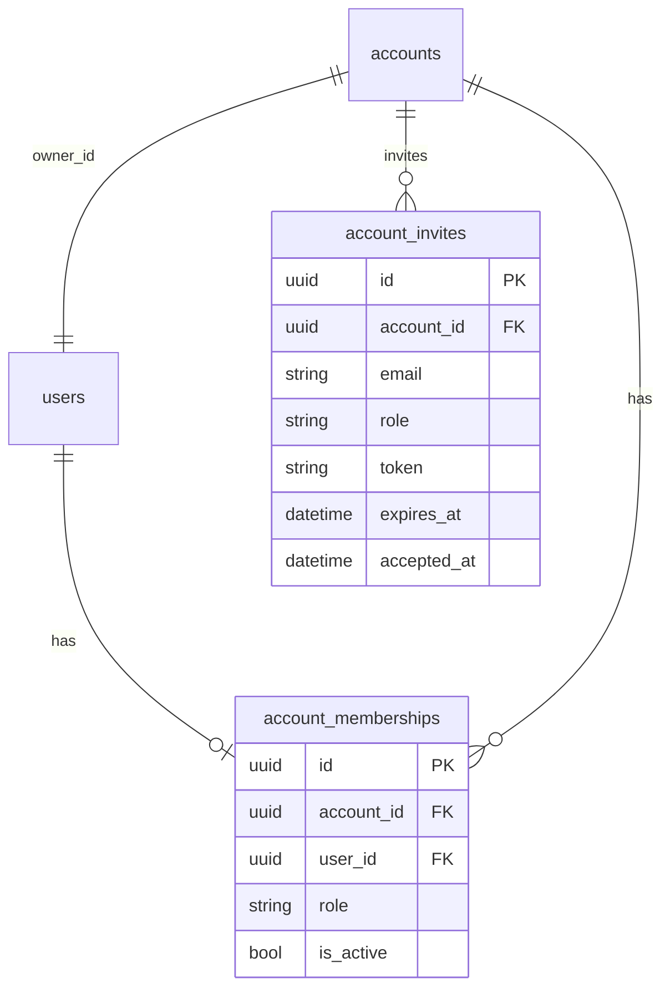

# Роли и доступ в аккаунте

Роли и приглашения участников аккаунта.

Реализация: [`permissions.py`](../backend/app/domain/permissions.py),
`backend/app/services/invite_service.py` и account routes.

---

## Модель доступа

- Роли: **owner / manager / accountant** с матрицей ниже.
- Участников приглашает owner по ссылке (email + full_name + role → письмо / ссылка → accept с паролем). Роли invite: `manager` / `accountant`.
- В текущей модели один user связан максимум с одной membership.
- Без transfer ownership и без account switcher.
- Источник правды — backend; frontend только скрывает недоступные действия.
- UI и дашборд общие для всех ролей; отличаются права на мутации и блоки «Команда» / «Аккаунт» у owner.

Backend проверяет права через membership из базы и `require_permissions(...)`;
скрытие кнопок в UI — только удобство интерфейса, не механизм защиты.

## Матрица прав

| Возможность | owner | manager | accountant |
|---|---|---|---|
| Команда (пригласить/сменить роль/удалить) | да | нет | нет |
| Настройки аккаунта / удаление аккаунта | да | нет | нет |
| Объекты, арендаторы, договоры, документы (CRUD) | да | да | только чтение |
| Платежи, начисления (generate), расходы, reminders | да | да | да |
| Дашборд, календарь, ledger, чтение всего | да | да | да |
| Свой профиль / пароль | да | да | да |

Реализация: enum `Role` + `Permission` + словарь `ROLE_PERMISSIONS` в [`backend/app/domain/permissions.py`](../backend/app/domain/permissions.py). Проверка через dependency `require_permissions(...)` → `ForbiddenError`.

## Модель данных

- Таблица `account_memberships`: `id`, `account_id`, `user_id`, `role` (`owner|manager|accountant`), `is_active`, timestamps.
- Таблица `account_invites`: pending invite (TTL 7 дней), `token` unique; accept создаёт user + membership.
- Constraints: `UNIQUE(account_id, user_id)`, `UNIQUE(user_id)` (один аккаунт на user в v1).
- `accounts.owner_id` **оставляем** (канонический владелец); при register создаём account + membership `role=owner`.

## Приглашения и ограничения модели

Owner может приглашать пользователей с ролями `manager` и `accountant` по
одноразовой ссылке; срок действия приглашения — 7 дней. Owner может отозвать
приглашение, менять роль участника и удалить участника. Роль `owner` нельзя
назначить через приглашение или обычную смену роли.

Текущие HTTP-маршруты и схемы смотри в OpenAPI для конкретного checkout; не
используй прежнюю таблицу проектных маршрутов ниже в git history как API
reference. Поддержка нескольких аккаунтов на одного пользователя и transfer
ownership в текущую модель не входят.
