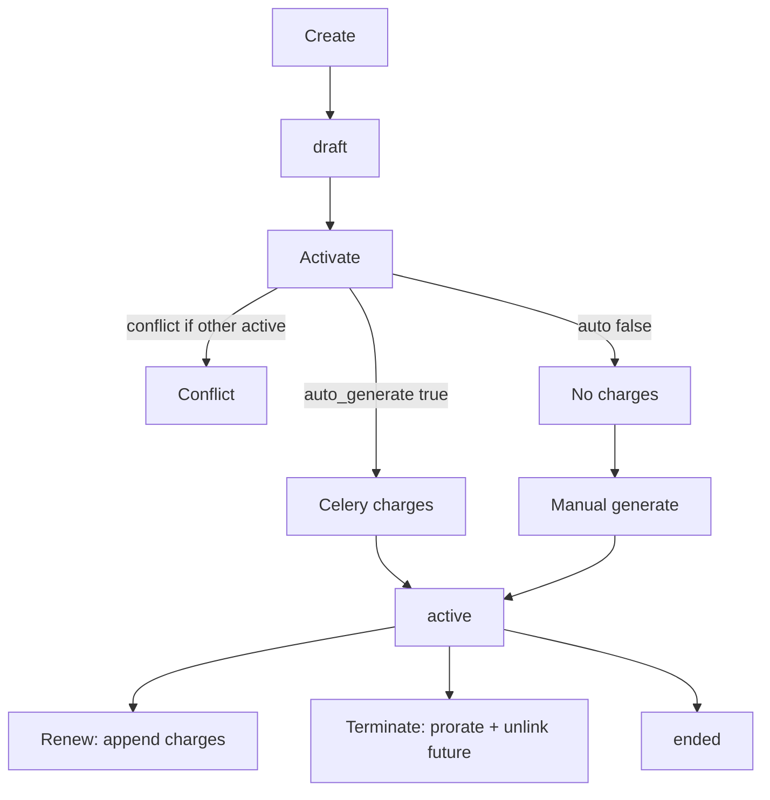
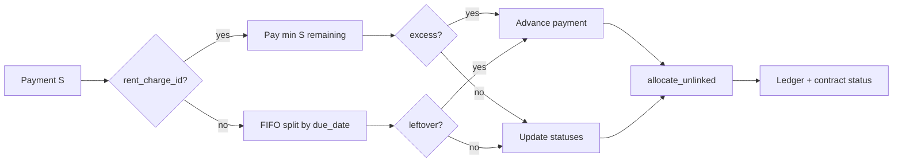

# Use cases: создание договора и внесение платежей

Актуально после P0–P3 денежного потока. Связано с [MONEY_FLOW.md](./MONEY_FLOW.md).

---

## Создание договора

### UC-C1. Новый черновик

1. Пользователь заполняет объект, арендатора, аренду, даты, `payment_day`, опционально депозит, флаг «Авто-начисления».
2. `POST /contracts` → статус всегда **`draft`**.
3. Начислений нет. Депозит — только поле (вне кассы / ledger).
4. Можно создать draft, даже если на объекте уже есть **active/overdue** (следующий договор «в запасе»).

### UC-C2. Редактирование draft

Меняются поля (суммы, даты, флаг авто-начислений). Charges не появляются, пока нет активации / ручной генерации.

### UC-C3. Активация с авто-начислениями

1. `draft → active` (кнопка «Активировать»).
2. Если на объекте уже другой active/overdue → **Conflict**.
3. Если `auto_generate_charges=true` → Celery создаёт charges по расписанию:
   - короткие первый/последний периоды — **prorate**;
   - `due_date` не раньше `period_start` (нет ложной просрочки mid-month).
4. UI показывает toast и poll’ит список начислений.

### UC-C4. Активация без авто-начислений

Договор становится active, charges пустые. Пользователь жмёт «Сгенерировать» (EmptyState или меню) → тот же Celery-эндпоинт.

### UC-C5. Включить авто-начисления позже (без смены статуса)

Флаг сохраняется, **генерация сама не стартует**. Нужна ручная генерация или активация с уже включённым флагом (в обычном пути — activate один раз).

### UC-C6. Продление (renew)

Новый `end_date` (± новая аренда) → дописываются charges на продлённый хвост → аванс договора (если был) раскладывается FIFO на новые периоды.

### UC-C7. Расторжение (terminate)

1. Статус `terminated`, `end_date` = effective date.
2. Текущий пересекающий период — укорачивается + prorate (не ниже уже оплаченного).
3. Future charges — удаляются; привязанные платежи → **аванс** (`rent_charge_id=None`), затем allocate на оставшиеся.

### UC-C8. Завершение (ended)

Обычный конец срока / ручной переход active→ended (без пересчёта как у terminate).

---

## Внесение платежей

Где: «Внести платёж» на карточке / PaymentModal; можно с привязкой к конкретному периоду или без.

### UC-P1. Платёж без charge (автораспределение)

1. Сумма S, `rent_charge_id = null`.
2. FIFO по `due_date` неоплаченных charges: создаются split-платежи на каждый остаток.
3. Хвост, если charges кончились → один payment без charge (**аванс**).
4. Статусы charges: `pending` / `partially_paid` / `paid` / `overdue` (если due прошёл и остаток > 0).
5. Договор: `active ↔ overdue` по наличию просроченных остатков.
6. API возвращает **все** созданные строки платежа.

### UC-P2. Платёж на конкретный charge

1. Проверка: charge принадлежит договору; остаток > 0.
2. В UI max = **остаток** (не полная сумма).
3. На charge уходит `min(S, remaining)`; избыток → отдельный аванс.
4. Потом снова `allocate_unlinked_payments` (аванс может покрыть другие периоды).

### UC-P3. Частичная оплата

Оплатили меньше остатка → `partially_paid`; после due → **`overdue`**, не «вечный partial».

### UC-P4. Переплата / аванс вперёд

Outstanding ledger `< 0` → в карточке блок **«Аванс»**. При появлении новых charges (generate / renew) аванс списывается FIFO автоматически.

### UC-P5. Платёж при draft

В UI разрешён (`canPay` включает draft). Имеет смысл после ручной генерации charges; без charges уйдёт целиком в аванс договора.

### UC-P6. Что видно в кассе (ledger)

- Строки: +charge / −payment, sort `(date, charge→payment, created_at)`.
- Баланс: `Σcharges − Σpayments` → к получению / сведено / аванс.
- Депозит **не** участвует.

---

## Шпаргалка «что делать в UI»

| Цель | Действия |
|------|----------|
| Подготовить следующий договор на занятом объекте | Создать draft сейчас; активировать после окончания/расторжения текущего |
| Старт аренды «с кнопки» | Activate + авто-начисления (или Activate → Сгенерировать) |
| Принять аренду за период | Платёж с выбранным charge (или без — FIFO сам разложит) |
| Принять предоплату | Платёж без charge / с избытком → аванс, потом спишется сам |
| Учесть залог | Поле депозита в договоре; в платежи аренды не вносить |
| Досрочно закрыть | Terminate — периоды пересчитаются, лишние платежи станут авансом |
